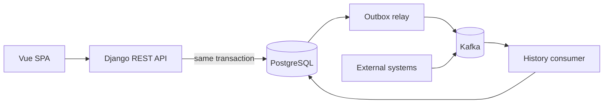

# Insurance Manager

A practice-oriented learning project: an insurance management portal built with
Django REST Framework, Vue 3, PostgreSQL and Apache Kafka, running on Docker and Kubernetes.

> **Status:** Work in progress – see the [roadmap](#roadmap).

## Goals

- Apply production-grade patterns (transactional outbox, idempotent consumers, session-based auth with CSRF protection)
- Document architectural trade-offs as [ADRs](docs/adr)
- Keep the whole system reproducible locally with Docker Compose and kind

## Tech stack

| Area | Technology |
| --- | --- |
| Backend | Python 3.14, Django 5.2 LTS, Django REST Framework, drf-spectacular |
| Messaging | Apache Kafka (KRaft), Strimzi on Kubernetes |
| Frontend | Vue 3, TypeScript, Vite, Vuetify, Pinia |
| Persistence | PostgreSQL 17 |
| Infrastructure | Docker, Kubernetes (kind), Kustomize, GitHub Actions |

## Architecture (planned)

## Roadmap

- [x] v0.1.0 – Foundation (repository, CI, ADRs)
- [ ] v0.2.0 – Backend core, authentication, CRUD API, OpenAPI
- [ ] v0.3.0 – Event pipeline (outbox, Kafka, insurance history)
- [ ] v0.4.0 – Frontend
- [ ] v0.5.0 – Kubernetes
- [ ] v1.0.0 – Documentation polish

## Architecture decisions

See [docs/adr](docs/adr).

## License

[MIT](LICENSE)
