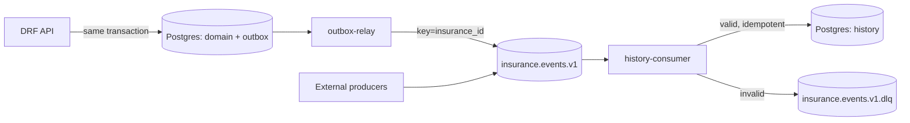

# Implementation Plan – Insurance Manager Portal

> Sprache: Plan auf Deutsch. **Sämtlicher Code, Bezeichner, Kommentare, Commit-Messages, API-Felder, Topic-Namen, UI-Texte, README und ADRs auf Englisch** (öffentliches GitHub-Repo).

## Plan Metadata

| Field | Value |
| --- | --- |
| Plan date | 2026-10-10 (Revision 2) |
| Repository / project | `insurance-manager` (`/Users/daniellanghann/src/edu/insurance-manager`) |
| Branch / reference | Not applicable (noch kein Git-Repository) |
| Plan scope | Greenfield: Versicherungsportal mit Kafka-basierter Historie; Lern- und Portfolio-Projekt auf GitHub, später optional Demo |
| Plan status | `Ready` |
| Author | Claude (create-plan) |

## Executive Summary

- **Objective:** Ein praxisnahes Versicherungsportal (Django/DRF, Vue 3, Postgres, Kafka, Docker, Kubernetes), das als öffentliches GitHub-Projekt nachvollziehbar dokumentiert, wie diese Technologien professionell eingesetzt werden. Die Architektur soll eine spätere Demo-Instanz ohne Umbau ermöglichen.
- **Recommended approach:** Monorepo, in **Meilensteinen als vertikale Slices** gebaut; jeder Meilenstein endet mit grüner CI, einem Git-Tag und einem ADR. Kafka-Historie über **Transactional Outbox → Kafka → idempotenter Consumer → Postgres-Read-Model**. Browser-Auth über **Django-Sessions in HttpOnly-Cookies + CSRF + Brute-Force-Schutz** statt JWT im `localStorage`. Kafka in Kubernetes über den **Strimzi-Operator**.
- **Why this approach:** Es sind jeweils die Lösungen, die man in Produktion vorfindet (Confluent-Patterns, OWASP-Empfehlung für SPAs auf derselben Origin, Operator-basiertes Kafka auf K8s). Gleichzeitig bleibt jede Komponente klein genug, um sie selbst zu verstehen.
- **Primary risks:** Scope-Creep (Lernprojekt ohne Deadline), Ressourcenbedarf lokal (kind + Strimzi), Event-Reihenfolge/Duplikate, versehentlich veröffentlichte Secrets oder Personendaten.
- **Blockers:** None

## Requirements and Scope

- **Requirement sources reviewed:** Anforderungstext (Chat, 2026-10-10), Antworten Rückfragen Runde 1, Feedback Runde 2 (Annahmen 1, 2, 3, 5 bestätigt; Auth robuster; Lern-/Praxis-/Portfolio-Ziel; ggf. Demo).
- **Validated requirements:**
  - R1 Stack: Django + DRF, Apache Kafka, Vue.js, Postgres, Docker + Kubernetes.
  - R2 Datenmodell: Insurance, InsuranceType, Provider, Benefit, Person, Invoice, User (E-Mail + Passwort).
  - R3 Insurance-Status: `active`, `cancelled`, `cancelled_by_insurer`.
  - R4 Historie pro Versicherung über Kafka; Events aus dem Portal **und** externen Systemen; Speicherung in Postgres.
  - R5 CRUD-API für alle Datentypen (History bewusst read-only, siehe ADR).
  - R6 OpenAPI + Swagger zur Doku und zum Testen.
  - R7 Kubernetes-Orchestrierung mit eigenen Einheiten/Nodes für Backend, Frontend, Kafka, Postgres.
  - R8 UI: Login; Startseite mit Versicherungsliste; Sidenav mit Home und Users.
  - R9 Users-Seite = Benutzerverwaltung (nur Staff).
  - R10 Alle eingeloggten User sehen und bearbeiten alle Versicherungen.
  - R11 Benefit `due_date` = Fälligkeitsdatum.
  - R12 Code ausschließlich auf Englisch.
  - **R13 (neu) Robuste Authentifizierung:** keine Tokens im JavaScript-Zugriff, CSRF-Schutz, Brute-Force-Schutz, sichere Passwort-Hashes, Session-Invalidierung bei Logout/Passwortänderung/Deaktivierung.
  - **R14 (neu) Portfolio-Tauglichkeit:** öffentliches Repo mit README, Architekturdiagrammen, ADRs, CI-Badges, Lizenz, Seed-Daten, nachvollziehbarer Commit-/Tag-Historie.
  - **R15 (neu) Demo-Readiness:** 12-Factor-Konfiguration, veröffentlichte Container-Images, Demo-Seed/Reset, keine echten Personendaten – ohne die Demo jetzt zu deployen.
- **Acceptance criteria:**
  - AC1 `make dev` (Docker Compose) und `make k8s-up` (kind) starten das komplette System reproduzierbar auf einem frischen Rechner nach README.
  - AC2 Ohne gültige Session liefert jeder API-Endpoint außer Login/CSRF/Health/Schema `403`; schreibende Requests ohne CSRF-Token `403`.
  - AC3 CRUD für jede Entität unter `/api/v1/…`, dokumentiert und ausführbar in Swagger (`/api/docs/`) nach Login.
  - AC4 Änderungen an Versicherungen/Rechnungen erscheinen innerhalb weniger Sekunden in `GET /api/v1/insurances/{id}/history/`, inkl. ausführendem User.
  - AC5 Extern produzierte, schema-valide Events erscheinen in der Historie; invalide landen in der DLQ, ohne den Consumer zu blockieren.
  - AC6 Doppelt zugestellte Events (gleiche `event_id`) erzeugen genau einen History-Eintrag.
  - AC7 Startseite: server-paginierte Liste (Policy number, Provider, Types, Monthly premium, Status); Sidenav Home/Users (Users nur Staff); Logout.
  - AC8 Staff kann User anlegen/bearbeiten/deaktivieren/löschen; niemand kann sich selbst löschen, deaktivieren oder den Staff-Status entziehen.
  - AC9 Nach 5 fehlgeschlagenen Logins (E-Mail + IP) ist der Login 15 Minuten gesperrt.
  - AC10 Session-Cookie ist `HttpOnly`, `SameSite=Lax`, in TLS-Umgebungen `Secure`; Logout und Passwortänderung invalidieren die Session.
  - AC11 In K8s laufen Backend, Frontend, Kafka und Postgres auf jeweils eigenem, gelabeltem Node; Datenbank-Nodes sind per Taint für andere Workloads gesperrt.
  - AC12 GitHub-Actions-CI ist auf `main` grün (Lint, Typecheck, Unit-, Integrations-, E2E-Smoke-Tests, Schema-Drift, Image-Build).
  - AC13 Im Repo befinden sich keine Secrets und keine realen Personendaten; Events enthalten keine Personendaten (nur IDs).
- **Out of scope (Kern):**
  - Externe Events ändern nicht den aktuellen Zustand (nur Historisierung) – siehe Stretch S6.
  - UI für Stammdaten-CRUD und Historie (API + Swagger decken es ab) – siehe Stretch S7.
  - Tatsächliches Deployment einer Demo, TLS, Monitoring-Stack, Schema Registry, Debezium – siehe Stretch Goals.
  - Passwort-Reset per E-Mail, Self-Registration, MFA, Mehrsprachigkeit.
- **Assumptions (bestätigt bzw. neu):**
  - A1 ✅ Custom User (`AbstractUser`-Subklasse, E-Mail-Login, kein `username`).
  - A2 ✅ Benefits, Persons, InsuranceTypes sind Stammdaten, M2M zur Versicherung.
  - A3 ✅ Benutzerverwaltung nur für `is_staff`.
  - A4 ✅ Löschen mit Abhängigkeiten → `409`.
  - A5 (neu) Django 5.2 LTS (Support bis April 2028) statt neuester Feature-Version – Stabilität vor Features.
  - A6 (neu) Lizenz MIT.
  - A7 (neu) Lokaler Cluster: kind; Kafka in Compose als `apache/kafka`-Container, in K8s via Strimzi.
  - A8 (neu) Externe Producer kennen die interne `insurance_id`.
  - A9 (neu) Python 3.14 (aktuelles stabiles Release mit Wheels aller Abhängigkeiten; 3.15 erst, wenn `confluent-kafka` Wheels liefert) und Node 24 (Active LTS).
- **Open questions (nicht blockierend):**
  - Q1 Sollen externe Events später den Zustand ändern (z. B. Status `cancelled_by_insurer`)? → S6.
  - Q2 Zielplattform einer späteren Demo (VPS mit k3s vs. Managed K8s) → erst bei S1 entscheiden.

## Plan Challenge (Revision 2)

Kritische Prüfung von Revision 1 mit Blick auf **Lernen, Praxisnähe und öffentliche Sichtbarkeit**:

| # | Challenge | Bewertung | Entscheidung |
| --- | --- | --- | --- |
| C1 | JWT im `localStorage` ist bei XSS auslesbar. | Für eine Browser-SPA auf derselben Origin sind Server-Sessions mit HttpOnly-Cookie Praxisstandard (OWASP, Django-Docs). JWT lohnt sich für Mobile-Apps und Service-to-Service-Kommunikation, die es hier nicht gibt (externe Systeme kommen über Kafka). | **Session + CSRF + django-axes + Argon2** (ADR-002). |
| C2 | Braucht man Kafka überhaupt für eine Historie in einem Monolithen? | Ehrlich: Nur für interne Änderungen würde eine History-Tabelle in derselben Transaktion genügen. Kafka wird erst durch **externe Event-Quellen** und mögliche weitere Consumer gerechtfertigt. Diese Abwägung im README offen darzulegen, wirkt im Portfolio besser als unbegründete Komplexität. | Beibehalten, Begründung in ADR-003. |
| C3 | Kafka als selbst gebautes StatefulSet ist in der Praxis unüblich und fehleranfällig (Listener, KRaft-Cluster-ID). | Strimzi ist der Standard-Operator (CNCF). Man lernt dabei Operatoren, CRDs und deklaratives Topic-Management (`KafkaTopic`). Postgres bleibt ein einfaches StatefulSet, um die K8s-Grundlagen selbst zu bauen. | **Strimzi** in K8s; CloudNativePG als Stretch S4 (ADR-006). |
| C4 | Personendaten in Events: Kafka-Logs und Historie sind unveränderlich, das kollidiert mit dem DSGVO-Löschrecht. | Ein echtes Praxisthema mit Lernwert. | **Keine Personendaten in Events**, nur IDs und Geschäftswerte (ADR-007); Seed-Daten nur mit Faker. |
| C5 | Bisher keine CI, kein Pre-Commit, keine ADRs. Für ein Portfolio ist das die halbe Wirkung. | Grüne CI-Badges, ADRs und saubere Tags zeigen Arbeitsweise, nicht nur Code. | Meilenstein M0 „Foundation“ mit GitHub Actions, Pre-Commit, ADR-Template, Dependabot. |
| C6 | Event-Pipeline nur mit Mocks getestet. | Integrationstests gegen echtes Kafka und Postgres via **Testcontainers** sind Praxisstandard und decken Serialisierung, Keys und Commits ab. | Integrationstest-Suite (`-m integration`) in CI. |
| C7 | Ein Health-Endpoint für Liveness und Readiness. | Liveness mit DB-Check führt bei DB-Ausfall zu Restart-Kaskaden. Relay und Consumer haben keinen HTTP-Port. | `/api/health/live` (ohne Abhängigkeiten), `/api/health/ready` (DB); Heartbeat-Datei + `exec`-Probe für Relay/Consumer. |
| C8 | Diff-Berechnung bei parallelen Updates nicht konsistent. | Ohne Zeilensperre kann ein Event einen falschen Altwert zeigen. | `select_for_update()` beim Update von Insurance/Invoice. |
| C9 | Outbox-Tabelle wächst unbegrenzt. | Betriebsthema. | `prune_outbox`-Command + K8s-CronJob (veröffentlichte Einträge > 7 Tage). |
| C10 | Ad-hoc-Validierung des Event-Formats im Consumer-Code. | Externe Producer brauchen einen **veröffentlichten Vertrag**. | JSON Schema `contracts/events/insurance-event.v1.schema.json`, genutzt im Consumer, in Tests und in der Doku. Schema Registry als Stretch S3. |
| C11 | Swagger UI lädt Assets vom CDN, das kollidiert mit einer strikten CSP. | Sicherheitsheader sind Teil von „robust“. | `drf-spectacular-sidecar` (Assets selbst gehostet), CSP-Header im nginx. |
| C12 | `kubectl apply` wartet nicht auf die Migrationen; Jobs sind unveränderlich. | Typische Stolperfalle. | `make k8s-up` in Stufen: Infra → `wait` → Migrate-Job neu anlegen → `wait --for=condition=complete` → Apps. |
| C13 | Tiers per `nodeSelector` festnageln ist nur halb praxisnah. | In der Praxis bekommen Daten-Nodes Taints und Stateful-Workloads Tolerations plus Node-Affinity. | Labels + Taints (`dedicated=data:NoSchedule`) für Kafka/Postgres-Nodes, Affinity für Apps (ADR-008). |
| C14 | Der Gesamtumfang ist groß; Risiko, nie „fertig“ zu werden. | Bei einem Lernprojekt ohne Deadline das größte Risiko. | Meilensteine M0–M5 als jeweils vorzeigbare Zustände mit Tags; alles Weitere als Stretch-Ziele. |
| C15 | Revision 1 enthielt kein Audit, wer eine Änderung ausgelöst hat. | Eine Versicherungshistorie ohne „wer“ ist in der Praxis wertlos. | `actor_user_id` und `correlation_id` (Request-ID) im Envelope. |

## Evidence Reviewed

| Source | Relevant evidence | Plan implication |
| --- | --- | --- |
| User-Anforderung (Chat) | Stack, Datenmodell, Historie, API, OpenAPI, K8s, UI, „Design Pattern: confluent.io“ | R1–R12 |
| Rückfragen Runde 1 | Events aus beiden Quellen; alle sehen alles; Users = Benutzerverwaltung; Fällig = Datum | R4, R9, R10, R11 |
| Feedback Runde 2 | A1, A2, A3, A5 ok; Auth robuster; Lernen + Praxis; GitHub-Portfolio; evtl. Demo | R13–R15, Challenge C1–C15 |
| `main.py` | PyCharm-Beispiel | Entfernen |
| `pyproject.toml` | `requires-python = ">=3.12"`, keine Dependencies (PyCharm-Default) | Wird ersetzt; Python 3.14 (siehe A9) |
| `.venv` | Python 3.12.13 (uv) | uv als Paketmanager; venv wird verworfen |
| PyPI (2026-10-11) | Django 5.2.18 und 6.1.2 unterstützen Python 3.14; `confluent-kafka` 2.16 hat Wheels bis cp314 (kein cp315); `psycopg-binary` bis cp315 | Python 3.14; 3.15 noch nicht (Kafka-Client) |
| Lokale Tools | docker, kubectl, kind, minikube, node v22.19.0, npm, uv | Node 24 LTS per nvm nachinstallieren, kind |
| Kein `.git` | Kein Repository | `git init` in M0 |

## Current State

- **Relevant files / modules:** Keine; Greenfield.
- **Existing patterns to follow:** Django-/DRF-Konventionen (eine App pro fachlichem Bereich, ViewSets + Router), Vue 3 Composition API (`<script setup lang="ts">`), 12-Factor-Konfiguration.
- **Reusable functionality:** Django Auth/Sessions/CSRF/Password-Validators/Admin, DRF ViewSets/Pagination/Permissions/Throttling, drf-spectacular, django-filter, django-axes, confluent-kafka, Strimzi CRDs, Vuetify-Komponenten.
- **Constraints:** Python 3.14, Node 24 LTS, Custom User vor der ersten Migration, Same-Origin-Betrieb (Ingress bzw. Vite-Proxy), lokale Ressourcen (Docker Desktop ≥ 8 GB RAM für kind + Strimzi).

## Proposed Approach

### Repository-Struktur

```
insurance-manager/
├── .github/
│   ├── workflows/            # backend.yml, frontend.yml, images.yml, e2e.yml
│   ├── dependabot.yml
│   └── pull_request_template.md
├── backend/
│   ├── pyproject.toml, uv.lock, Dockerfile, manage.py
│   ├── config/               # settings.py, urls.py, wsgi.py, gunicorn.conf.py
│   ├── accounts/             # User model, auth endpoints, user management
│   ├── insurance/            # domain models + CRUD API
│   ├── events/               # outbox, relay, consumer, history read model
│   ├── core/                 # health, exception handler, request-id middleware
│   └── tests/                # unit/, api/, integration/
├── frontend/
│   ├── package.json, vite.config.ts, Dockerfile, nginx.conf
│   ├── src/ (api/, stores/, router/, layouts/, views/, components/)
│   └── e2e/                  # Playwright smoke tests
├── contracts/
│   ├── openapi/schema.yaml   # generated, committed, drift-checked in CI
│   └── events/insurance-event.v1.schema.json
├── deploy/
│   ├── kind-cluster.yaml
│   └── k8s/ base/ + overlays/local/ (+ overlays/demo/ later)
├── docs/
│   ├── IMPLEMENTATION_PLAN.md
│   ├── architecture.md       # Mermaid diagrams (rendered by GitHub)
│   ├── events.md             # event contract for external producers
│   └── adr/                  # 0001-…md
├── docker-compose.yml, Makefile, .pre-commit-config.yaml, .env.example
├── README.md, LICENSE
```

### Datenmodell

| Model | Fields |
| --- | --- |
| `accounts.User` (`AbstractUser`) | `email` (unique, `USERNAME_FIELD`), `password`, `is_active`, `is_staff`, `date_joined`, `last_login`; `username = None`, eigener `UserManager` |
| `AddressMixin` (abstract) | `street`, `postal_code`, `city`, `country` (default `"DE"`) |
| `Provider` | `id`, `company_name` (unique), Address-Felder |
| `InsuranceType` | `id`, `name` (unique), `description` |
| `Benefit` | `id`, `name`, `description`, `monthly_amount`, `fixed_amount` (Decimal(12,2), ≥0, default 0), `due_date` (Date, nullable) |
| `Person` | `id`, `last_name`, `first_name`, Address-Felder, `date_of_birth` (nicht in der Zukunft) |
| `Insurance` | `id`, `policy_number` (unique), `provider` (FK, `PROTECT`), `types`/`benefits`/`insured_persons` (M2M), `monthly_premium` (Decimal(12,2), ≥0), `summary`, `status` (`active`/`cancelled`/`cancelled_by_insurer`), `created_at`, `updated_at` |
| `Invoice` | `id`, `invoice_number` (unique), `insurance` (FK, `PROTECT`), `net_amount`, `gross_amount` (≥ net), `invoice_date` |
| `events.OutboxEvent` | `id` (UUID = `event_id`), `topic`, `key`, `payload` (JSON), `created_at`, `published_at` (nullable, partieller Index auf `NULL`) |
| `events.InsuranceHistoryEntry` | `id`, `event_id` (UUID, unique), `insurance_id` (BigInteger, indexiert, **kein FK**), `event_type`, `event_version`, `source`, `actor_user_id` (nullable), `correlation_id` (nullable), `occurred_at`, `payload` (JSON), `kafka_partition`, `kafka_offset`, `received_at` |

### Authentifizierung und Sicherheit (R13)

- **Mechanismus:** DRF `SessionAuthentication`; Sessions in der DB (funktioniert ohne Redis über mehrere Replicas hinweg).
- **Endpoints:**
  - `GET /api/v1/auth/csrf/` – setzt das CSRF-Cookie (`ensure_csrf_cookie`).
  - `POST /api/v1/auth/login/` – `csrf_protect`, `authenticate(request, email, password)`, `login()` mit Session-Key-Rotation gegen Session Fixation. Bei Fehlern immer eine generische Meldung.
  - `POST /api/v1/auth/logout/` – Session löschen.
  - `GET /api/v1/auth/me/` – aktueller User inkl. `is_staff`.
  - `POST /api/v1/auth/password/` – altes und neues Passwort, Django-Validatoren, `update_session_auth_hash`. Andere Sessions werden durch den geänderten Passwort-Hash automatisch ungültig.
- **Cookies:** `SESSION_COOKIE_HTTPONLY=True`, `SESSION_COOKIE_SAMESITE="Lax"`, `SESSION_COOKIE_SECURE`/`CSRF_COOKIE_SECURE` per Env (in TLS-Umgebungen an), `SESSION_COOKIE_AGE=8h`, `CSRF_TRUSTED_ORIGINS` per Env. Das CSRF-Cookie ist absichtlich für JavaScript lesbar (Double-Submit über den Header `X-CSRFToken`).
- **Brute-Force-Schutz:** `django-axes` (DB-basiert, also über alle Replicas hinweg): 5 Fehlversuche pro E-Mail+IP, 15 Minuten Sperre, Antwort `429` mit generischer Meldung. Proxy-Konfiguration (`AXES_IPWARE_PROXY_COUNT`) für Ingress/nginx. Zusätzlich DRF-`ScopedRateThrottle` auf den Login als zweite Schicht.
- **Passwörter:** Argon2 (`django[argon2]`) als primärer Hasher, Django-Standard-Validatoren mit `MinimumLengthValidator(12)`.
- **Benutzerverwaltung:** `IsAdminUser`. Self-Delete, Self-Deactivate und Self-Demote sind verboten; der letzte aktive Staff-User ist geschützt. Das Passwort ist write-only. Deaktivierte User verlieren sofort ihren Zugriff (`ModelBackend` lehnt inaktive User ab).
- **Security-Header:** Django `SecurityMiddleware` (`nosniff`, `Referrer-Policy`, HSTS per Env), `X_FRAME_OPTIONS=DENY`. nginx (Frontend) setzt eine CSP: `default-src 'self'; style-src 'self' 'unsafe-inline'` (Vuetify-Theme), `frame-ancestors 'none'`.
- **Swagger:** Assets über `drf-spectacular-sidecar`; Auth per Session-Cookie (Login im Portal oder `/admin`), CSRF-Header setzt drf-spectacular automatisch.
- **Admin:** `/admin/` nur für Staff, ebenfalls durch axes geschützt.

### API (`/api/v1/`)

| Resource | Endpoint | Permission |
| --- | --- | --- |
| Auth | `auth/csrf/`, `auth/login/`, `auth/logout/`, `auth/me/`, `auth/password/` | public bzw. authenticated |
| Users | `users/` CRUD | `IsAdminUser` |
| Providers, insurance types, benefits, persons | `providers/`, `insurance-types/`, `benefits/`, `persons/` CRUD | authenticated |
| Insurances | `insurances/` CRUD; Filter `status`, `provider`, `types`; Suche `policy_number`; Sortierung | authenticated |
| Invoices | `invoices/` CRUD; Filter `insurance`, Datumsbereich | authenticated |
| History | `insurances/{id}/history/` read-only, paginiert | authenticated |
| Health | `/api/health/live`, `/api/health/ready` | public |
| OpenAPI | `/api/schema/`, `/api/docs/` (Swagger), `/api/redoc/` | public (nur Doku) |

- Schreibend werden IDs übergeben, lesend zusätzlich `provider_name`/`type_names`; `select_related`/`prefetch_related` gegen N+1-Abfragen.
- Einheitliches Fehlerformat über einen eigenen Exception-Handler (`ProtectedError` → `409`).
- `PageNumberPagination` (25, maximal 100).
- Request-ID-Middleware: übernimmt `X-Request-ID` oder erzeugt eine, gibt sie in Logs und Responses aus und schreibt sie als `correlation_id` in Events.

### Event-Architektur (Confluent-Patterns)



- **Envelope** (Vertrag: `contracts/events/insurance-event.v1.schema.json`):
  ```json
  {
    "event_id": "uuid",
    "event_type": "insurance.status_changed",
    "event_version": 1,
    "occurred_at": "2026-10-10T12:00:00Z",
    "source": "portal",
    "insurance_id": 42,
    "actor_user_id": 3,
    "correlation_id": "uuid",
    "payload": { "changes": { "status": ["active", "cancelled"] } }
  }
  ```
- **Event-Typen:** `insurance.created|updated|status_changed|premium_changed|deleted`, `invoice.created|updated|deleted`. Ein Update erzeugt je nach Diff `status_changed`, `premium_changed` und/oder `updated` (übrige Felder inkl. M2M-ID-Listen). **Keine Personendaten im Payload** (nur `insured_person_ids`).
- **Outbox:** `events.services.record_*_event()` wird explizit (nicht über Signals) in `transaction.atomic()` aufgerufen. Updates sperren die Zeile per `select_for_update()`, bevor der Diff berechnet wird.
- **Relay** (`manage.py publish_outbox`): Batches mit `SELECT … FOR UPDATE SKIP LOCKED` in der Reihenfolge `created_at`, idempotenter Producer (`enable.idempotence=true`, `acks=all`), `published_at` erst nach Delivery-Bestätigung; 1 Replica mit `Recreate`-Strategie; Heartbeat-Datei; SIGTERM-Handling.
- **Consumer** (`manage.py consume_history_events`): Group `history-projector`, `enable.auto.commit=false`, Validierung per JSON Schema (`jsonschema`), `bulk_create(ignore_conflicts=True)` auf `event_id`, Offset-Commit nach dem DB-Commit; Fehler → DLQ (Fehlergrund in Headern) + Commit; Heartbeat-Datei; SIGTERM-Handling.
- **Topics:** `insurance.events.v1` (3 Partitionen, Retention 30 Tage; Postgres ist der dauerhafte Speicher; Replay ist dank Idempotenz sicher), `insurance.events.v1.dlq` (Retention 30 Tage). `auto.create.topics.enable=false`. In K8s als Strimzi-`KafkaTopic`-CRs, in Compose per Init-Container.
- **Hilfs-Commands:** `produce_external_event` (externe Events simulieren), `prune_outbox`, `seed_demo_data` (Faker, deterministischer Seed, idempotent).

### Frontend

- Vue 3 + Vite + TypeScript, Vue Router, Pinia, Vuetify 3, axios (`xsrfCookieName="csrftoken"`, `xsrfHeaderName="X-CSRFToken"`).
- API-Typen werden mit `openapi-typescript` aus `contracts/openapi/schema.yaml` generiert; die CI prüft, ob sie aktuell sind.
- App-Start: `GET auth/csrf/` und `GET auth/me/` → Auth-Store. Router-Guards für `auth` und `staff`. Ein globaler 403-Handler führt bei abgelaufener Session zum Login.
- Views: `LoginView` (inkl. Anzeige der Sperre bei `429`), `DefaultLayout` (`v-navigation-drawer`: Home, Users nur für Staff; App-Bar mit Logout), `HomeView` (`v-data-table-server`, EUR-Formatierung über `Intl.NumberFormat`, Status-Chip), `UsersView` (Tabelle, Create/Edit-Dialog, Delete-Bestätigung als Vuetify-Dialog, Feldfehler aus der API).
- Kein `v-html`, damit die XSS-Fläche minimal bleibt.

### Infrastruktur

- **Images:** `backend/Dockerfile` (python:3.14-slim, multi-stage mit uv, Non-Root, gunicorn; ein Image für API, Relay, Consumer und die Jobs), `frontend/Dockerfile` (node:24-alpine → nginx-unprivileged). Tags = Git-SHA; Push nach GHCR aus der CI.
- **Compose (Dev):** postgres:17, apache/kafka (KRaft), kafka-init, backend (runserver + Volume), outbox-relay, history-consumer, frontend (vite dev). `make dev` / `make dev-down`.
- **Kubernetes (Kustomize + kind):**
  - `kind-cluster.yaml`: 1 Control-Plane + 4 Worker mit den Labels `tier=frontend|backend|kafka|postgres`; die Nodes `kafka` und `postgres` bekommen den Taint `dedicated=data:NoSchedule`. Port-Mapping 80 → ingress-nginx.
  - Postgres: StatefulSet + PVC + Headless Service + Secret, Toleration + Node-Affinity.
  - Kafka: Strimzi-Operator (Version gepinnt) + `Kafka`/`KafkaNodePool` (KRaft, 1 Node, kombinierte Rollen) + `KafkaTopic`-CRs, Toleration + Affinity über Pod-Templates.
  - Backend: `backend-api` (2 Replicas, Live- und Ready-Probe), `outbox-relay` (1, `Recreate`), `history-consumer` (1), Job `backend-migrate`, CronJob `prune-outbox`.
  - Frontend: Deployment + Service.
  - Ingress: `/api`, `/admin`, `/static` → Backend, `/` → Frontend.
  - Härtung: `runAsNonRoot`, `readOnlyRootFilesystem` (`emptyDir` für `/tmp`), alle Capabilities gedroppt, Requests/Limits.
  - Secrets: Kustomize-`secretGenerator` aus einer per gitignore ausgeschlossenen `deploy/k8s/overlays/local/.env`; das Makefile erzeugt sie aus `.env.example` mit zufälligen Werten.
- **CI (GitHub Actions):**
  - `backend.yml`: uv sync → ruff → `makemigrations --check` → Schema-Validierung + Drift-Check → pytest (Unit/API gegen Postgres-Service) → Integrationstests (Testcontainers Kafka + Postgres).
  - `frontend.yml`: npm ci → eslint → vue-tsc → Typen-Drift → vitest → build.
  - `e2e.yml`: Compose-Stack hochfahren → Seed → Playwright-Smoke (Login → Liste → Users → Logout).
  - `images.yml`: Build und Push nach GHCR auf `main` und bei Tags.
  - Dependabot (pip/uv, npm, GitHub Actions, Docker). Secret Scanning mit Push-Protection in den Repo-Einstellungen aktivieren (für öffentliche Repos kostenlos).
  - Kind-Smoke in der CI nur per `workflow_dispatch` (dauert lange; Stretch S2).

### Key Design Decisions (als ADRs in `docs/adr/`)

| ADR | Entscheidung |
| --- | --- |
| 0001 | Monorepo mit Backend, Frontend, Contracts und Deploy |
| 0002 | Session-Cookie-Auth + CSRF + django-axes statt JWT (SPA auf derselben Origin) |
| 0003 | Historie als Read-Model in Postgres; Kafka als Transport und Integrationspunkt für externe Quellen (inkl. ehrlicher Abwägung, siehe C2) |
| 0004 | Transactional Outbox mit Polling-Relay; Debezium als bewusst verschobene Alternative |
| 0005 | Ein Topic, Key = `insurance_id`, versioniertes JSON-Envelope mit JSON Schema |
| 0006 | Strimzi für Kafka in K8s, einfaches StatefulSet für Postgres |
| 0007 | Keine Personendaten in Events |
| 0008 | Platzierung per Node-Labels/Taints/Affinity im lokalen Cluster |

- **Alternatives considered:** JWT (C1), Signals statt expliziter Services (implizit, M2M-Diffs schwierig), Debezium/Schema Registry/CloudNativePG (wertvoll, aber als Stretch nach dem Kern), Helm statt Kustomize (Kustomize ist in kubectl eingebaut und reicht für ein Overlay-Szenario; Helm-Chart als Stretch S5).
- **New dependencies:**
  - Backend: `django~=5.2`, `djangorestframework`, `drf-spectacular[sidecar]`, `django-filter`, `django-axes[ipware]`, `argon2-cffi` (über `django[argon2]`), `psycopg[binary]`, `confluent-kafka`, `jsonschema`, `gunicorn`, `whitenoise`; Dev: `pytest`, `pytest-django`, `pytest-cov`, `factory-boy`, `faker`, `testcontainers[kafka,postgres]`, `ruff`, `pre-commit`.
  - Frontend: `vue`, `vue-router`, `pinia`, `vuetify`, `axios`; Dev: `vite`, `typescript`, `vue-tsc`, `vitest`, `@vue/test-utils`, `eslint`, `prettier`, `openapi-typescript`, `@playwright/test`.
  - Infra: `postgres:17`, `apache/kafka` (4.x), Strimzi (aktuelle Version, gepinnt), ingress-nginx, `nginxinc/nginx-unprivileged`.
  - Exakte Versionen über `uv.lock` / `package-lock.json` / gepinnte Image-Tags.

## Implementation Steps

Jeder Meilenstein endet mit: grüner CI, aktualisiertem README-Abschnitt, mindestens einem ADR und einem Git-Tag.

### M0 – Foundation (`v0.1.0`)

| Step | Files / areas | Change | Rationale | Dependencies | Status |
| --- | --- | --- | --- | --- | --- |
| 0.1 | Repo-Root | `git init -b main`, Repo-lokale Noreply-Commit-E-Mail, `.gitignore`, `.editorconfig`, `main.py`, Root-`pyproject.toml` und Root-`.venv` entfernen, `LICENSE` (MIT), README-Skelett | Saubere, öffentliche Basis | – | Planned |
| 0.2 | `backend/pyproject.toml`, `backend/.python-version`, `backend/uv.lock` | Minimales uv-Projekt (`package = false`), Ruff-Konfiguration, Dev-Gruppe mit `ruff` | Ruff-Config + Lockfile ab dem ersten Commit | 0.1 | Planned |
| 0.3 | `.pre-commit-config.yaml` | pre-commit-hooks (inkl. detect-private-key), ruff, ruff-format; Prettier erst in M3 mit dem Frontend (das Mirror-Repo ist archiviert) | Qualität vor jedem Commit | 0.2 | Planned |
| 0.4 | `docs/adr/0000-template.md`, `0001-monorepo.md` | ADR-Format (Context / Decision / Consequences) | Entscheidungen dokumentieren | 0.1 | Planned |
| 0.5 | `.github/workflows/ci.yml`, `dependabot.yml`, PR-Template | CI-Job `pre-commit`; `backend.yml` kommt in M1, `frontend.yml` in M3 (ohne Code würden sie nur leer laufen oder fehlschlagen) | CI von Anfang an | 0.3 | Planned |
| 0.6 | `Makefile`, `.env.example` | Target `lint` aktiv, `dev`, `test`, `schema`, `k8s-up`, `k8s-down` als Platzhalter | Einheitlicher Einstieg | 0.1 | Planned |
| 0.7 | GitHub | `gh repo create DanielLanghann/insurance-manager --public`, Push, CI grün, Tag `v0.1.0` | Veröffentlichung | 0.1–0.6 | Planned |

### M1 – Backend Core + Auth + API (`v0.2.0`)

| Step | Files / areas | Change | Rationale | Dependencies | Status |
| --- | --- | --- | --- | --- | --- |
| 1.1 | `backend/` | uv-Projekt, Django 5.2 + Dependencies, `config/` mit Env-Settings, `core/` (Request-ID-Middleware, Exception-Handler, Health live/ready), JSON-Logging | Lauffähiges Skelett | M0 | Planned |
| 1.2 | `accounts/` | Custom `User` + `UserManager`, `AUTH_USER_MODEL`, Admin, **erste Migration** | Django-Vorgabe: vor allen anderen Migrationen | 1.1 | Planned |
| 1.3 | `accounts/`, `config/settings.py` | Session-Auth-Endpoints, Cookie-/CSRF-Settings, Argon2, Validatoren, django-axes, Login-Throttle, Security-Header | R13 | 1.2 | Planned |
| 1.4 | `accounts/` | User-Management-ViewSet (Staff, Self-Protection, Schutz des letzten Staff-Users) | R9, AC8 | 1.3 | Planned |
| 1.5 | `insurance/models.py`, `admin.py` | Domain-Models, Constraints (`CheckConstraint` gross ≥ net, Beträge ≥ 0), Migrationen | R2, R3, R11 | 1.2 | Planned |
| 1.6 | `insurance/serializers.py`, `views.py`, `filters.py`, `urls.py` | CRUD-ViewSets, Filter, Pagination, Query-Optimierung | R5, R10 | 1.5 | Planned |
| 1.7 | `config/urls.py`, `contracts/openapi/` | drf-spectacular + Sidecar, Session-Security-Scheme, `extend_schema`, Schema committen + Drift-Check in CI | R6 | 1.4, 1.6 | Planned |
| 1.8 | `insurance/management/commands/seed_demo_data.py` | Faker-Seed (Provider, Typen, Benefits, Personen, Versicherungen, Rechnungen, Admin- + Normaluser) | Demo, Screenshots, E2E | 1.6 | Planned |
| 1.9 | `backend/tests/` | Unit-/API-/Auth-/Security-Tests (siehe Verification) | Absicherung | 1.3–1.8 | Planned |
| 1.10 | `docs/adr/0002-…` | ADR Auth | Dokumentation | 1.3 | Planned |

### M2 – Event Pipeline (`v0.3.0`)

| Step | Files / areas | Change | Rationale | Dependencies | Status |
| --- | --- | --- | --- | --- | --- |
| 2.1 | `contracts/events/`, `docs/events.md` | JSON Schema v1 + Doku mit Beispielen für externe Producer | Vertrag zuerst (C10) | M1 | Planned |
| 2.2 | `events/models.py`, `services.py`, `envelope.py` | `OutboxEvent`, Envelope-Builder, Diff-Logik, Einbindung in Insurance-/Invoice-ViewSets (`atomic` + `select_for_update`) | Outbox (C8, C15) | 2.1 | Planned |
| 2.3 | `events/kafka.py`, `management/commands/publish_outbox.py`, `prune_outbox.py` | Producer-Factory, Relay-Loop, Heartbeat, SIGTERM, Pruning | Events nach Kafka (C9) | 2.2 | Planned |
| 2.4 | `events/models.py`, `management/commands/consume_history_events.py` | `InsuranceHistoryEntry`, Schema-Validierung, idempotenter Insert, manuelle Commits, DLQ, Heartbeat | R4, AC5, AC6 | 2.1, 2.3 | Planned |
| 2.5 | `insurance/views.py`, `events/management/commands/produce_external_event.py` | History-Action, Simulator für externe Events | AC4, AC5 | 2.4 | Planned |
| 2.6 | `docker-compose.yml`, `backend/Dockerfile` | Dev-Stack mit Kafka (KRaft) + Topic-Init, `make dev` | AC1 | 2.3, 2.4 | Planned |
| 2.7 | `backend/tests/integration/` | Testcontainers: API-Änderung → Relay → Kafka → Consumer → History; Duplikat; DLQ | C6 | 2.5 | Planned |
| 2.8 | `docs/adr/0003…0005`, `0007` | ADRs zu Events | Dokumentation | 2.5 | Planned |

### M3 – Frontend (`v0.4.0`)

| Step | Files / areas | Change | Rationale | Dependencies | Status |
| --- | --- | --- | --- | --- | --- |
| 3.1 | `frontend/` | Scaffold (`npm create vue@latest`: TS, Router, Pinia, Vitest, ESLint, Prettier), Vuetify, Vite-Proxy, Typgenerierung | Skelett | M1 | Planned |
| 3.2 | `src/api/`, `stores/auth.ts`, `router/` | axios mit CSRF, Auth-Store (`csrf`/`me`/`login`/`logout`), Guards, 403-Handling | R8, R13 | 3.1 | Planned |
| 3.3 | `layouts/DefaultLayout.vue`, `views/LoginView.vue`, `views/HomeView.vue` | Layout mit Sidenav, Login (inkl. Sperr-Hinweis), Versicherungstabelle | R8, AC7 | 3.2 | Planned |
| 3.4 | `views/UsersView.vue`, `components/UserFormDialog.vue`, `components/ConfirmDialog.vue` | Benutzerverwaltung | R9, AC8 | 3.2 | Planned |
| 3.5 | `frontend/Dockerfile`, `nginx.conf` | Multi-Stage-Build, SPA-Fallback, CSP/Security-Header, `/api`-Proxy für Compose-Prod-Modus | Image | 3.3 | Planned |
| 3.6 | `frontend/e2e/`, `.github/workflows/e2e.yml` | Playwright-Smoke gegen den Compose-Stack | Durchgängige Absicherung | 3.4, 2.6 | Planned |

### M4 – Kubernetes (`v0.5.0`)

| Step | Files / areas | Change | Rationale | Dependencies | Status |
| --- | --- | --- | --- | --- | --- |
| 4.1 | `deploy/kind-cluster.yaml` | 1 + 4 Nodes, Labels, Taints, Port-Mapping | R7, AC11 | M3 | Planned |
| 4.2 | `deploy/k8s/base/postgres/` | StatefulSet, PVC, Service, Secret-Referenz, Probes, Toleration/Affinity | R7 | 4.1 | Planned |
| 4.3 | `deploy/k8s/base/kafka/` | Strimzi `Kafka` + `KafkaNodePool` + `KafkaTopic`s; Operator-Installation mit gepinnter Version im Makefile | R7, C3 | 4.1 | Planned |
| 4.4 | `deploy/k8s/base/backend/` | API-Deployment, Relay, Consumer, Migrate-Job, Prune-CronJob, ConfigMap, Probes, securityContext | R7, C7 | 4.2, 4.3 | Planned |
| 4.5 | `deploy/k8s/base/frontend/`, `ingress.yaml` | Deployment, Service, Ingress | R7 | 4.4 | Planned |
| 4.6 | `deploy/k8s/overlays/local/`, `Makefile` | secretGenerator, Image-Tags, gestuftes `make k8s-up` mit `kubectl wait` und `kind load docker-image` | AC1, C12 | 4.5 | Planned |
| 4.7 | `.github/workflows/images.yml` | Images nach GHCR (Tags: SHA + Semver) | R15 | 4.6 | Planned |
| 4.8 | `docs/adr/0006`, `0008` | ADRs K8s | Dokumentation | 4.6 | Planned |

### M5 – Portfolio Polish (`v1.0.0`)

| Step | Files / areas | Change | Rationale | Dependencies | Status |
| --- | --- | --- | --- | --- | --- |
| 5.1 | `README.md` | Pitch, CI-Badges, Architekturdiagramm (Mermaid), Screenshots/GIF, Quickstart (Compose + kind), Tech-Stack mit Begründung, Link zu den ADRs, Abschnitt „What I learned / trade-offs“, Roadmap (Stretch-Ziele) | R14 | M4 | Planned |
| 5.2 | `docs/architecture.md` | Kontext-, Container- und Sequenzdiagramm (Event-Flow), Datenmodell (Mermaid ER) | R14 | M4 | Planned |
| 5.3 | GitHub-Repo-Einstellungen | Beschreibung, Topics, Branch-Protection auf `main` (CI erforderlich), Secret-Scanning, Release `v1.0.0` mit Changelog | R14 | 5.1 | Planned |

### Stretch Goals (nach v1.0.0, jeweils eigenes ADR)

| ID | Ziel | Lernwert |
| --- | --- | --- |
| S1 | Demo-Deployment: `overlays/demo` (TLS über cert-manager, `Secure`-Cookies, HSTS, nächtlicher Reset per CronJob mit `seed_demo_data`, Demo-User ohne Staff-Rechte, Rate-Limit am Ingress) | Echter Betrieb |
| S2 | kind-Smoke-Test in der CI (`helm/kind-action`) | CI für Infrastruktur |
| S3 | Confluent Schema Registry + JSON-Schema-Serializer | Schema-Evolution |
| S4 | CloudNativePG statt eigenem StatefulSet (Backups, Failover) | DB-Operatoren |
| S5 | Helm-Chart oder GitOps mit Argo CD | Deployment-Praxis |
| S6 | Externe Events ändern den Zustand (Q1), z. B. `cancelled_by_insurer` | Event-getriebene Zustandsänderung, Konfliktregeln |
| S7 | Detailansicht mit History-Timeline und Stammdaten-UI | Frontend-Tiefe |
| S8 | Observability: Prometheus-Metriken (`django-prometheus`, Consumer-Lag), Grafana | Betrieb |
| S9 | Debezium-Outbox statt Polling-Relay | CDC |
| S10 | NetworkPolicies (vorher prüfen, ob die kind-CNI sie durchsetzt; sonst Calico/Cilium) | Netzwerksicherheit |

## Verification Plan

- **Automated tests to add or update:**
  - `tests/unit/accounts/test_user_model.py`: E-Mail-Login, `createsuperuser` ohne Username, E-Mail unique/case-insensitive.
  - `tests/api/test_auth.py`: Login ok/falsch (generische Meldung); CSRF fehlt → 403; Session-Cookie-Flags; Logout invalidiert die Session; inaktiver User kann sich nicht einloggen und alte Session ist ungültig; Passwortänderung invalidiert andere Sessions; Sperre nach 5 Fehlversuchen → 429; `me` ohne Session → 403.
  - `tests/api/test_users.py`: Nicht-Staff → 403; CRUD als Staff; Passwort nie im Response; Validatoren; Self-Delete/-Deactivate/-Demote → 400; letzter Staff geschützt.
  - `tests/api/test_<resource>.py` für jede Ressource: CRUD, Pflichtfelder, Unique, Choices, negative Beträge, `gross < net`, Geburtsdatum in der Zukunft, mehr als 2 Nachkommastellen, unbekannte M2M-IDs, Delete mit Abhängigkeiten → 409, Pagination, Filter, zwei User sehen dieselben Daten (R10), Anzahl der Queries beim Listen begrenzt (`django_assert_max_num_queries`).
  - `tests/unit/events/test_outbox.py`: Event-Typen je Änderung, Diff inkl. M2M, `actor_user_id`/`correlation_id` gesetzt, keine Personendaten im Payload, Rollback → keine Outbox-Zeile, jedes Event ist schema-valide.
  - `tests/unit/events/test_relay.py` / `test_consumer.py` (gemockter Producer/Consumer): Reihenfolge, Key, `published_at` erst nach Ack; Idempotenz, DLQ-Pfade (invalides JSON, Schema-Verletzung, unbekannter Typ), Commit-Reihenfolge.
  - `tests/integration/test_event_pipeline.py` (Testcontainers): End-to-End inklusive Duplikat und DLQ.
  - `tests/api/test_history.py`: Filterung pro Versicherung, Sortierung, Pagination, Historie bleibt nach dem Löschen erhalten.
  - Frontend Vitest: Auth-Store, Guards (Login-Redirect, Staff-Route), HomeView-Rendering/Pagination, UsersView-Flows, 429-Anzeige.
  - Playwright: Login → Liste sichtbar → Users (Staff) → Logout; Nicht-Staff sieht „Users“ nicht.
- **Manual checks:**
  - Swagger: Login, CRUD je Ressource, History.
  - `make dev`: Status ändern → History; `produce_external_event` → Eintrag mit `source != portal`; kaputtes Event per `kafka-console-producer.sh` → DLQ, Consumer läuft weiter; Kafka stoppen → API funktioniert weiter, Relay holt nach dem Neustart auf.
  - `make k8s-up`: `kubectl get pods -o wide` → Pods auf den erwarteten Nodes; nichts Fremdes auf den Daten-Nodes; UI unter `http://localhost`; Consumer-Pod löschen → keine Duplikate.
  - Browser-DevTools: Session-Cookie `HttpOnly`, CSP-Header aktiv, keine Konsolenfehler.
- **Commands to run:**
  - `make lint` → ruff, eslint, prettier, vue-tsc ohne Findings
  - `cd backend && uv run python manage.py makemigrations --check --dry-run` → „No changes detected“
  - `make schema && git diff --exit-code contracts/ frontend/src/api/` → kein Drift
  - `cd backend && uv run pytest -m "not integration" --cov` → grün
  - `cd backend && uv run pytest -m integration` → grün (Docker nötig)
  - `cd frontend && npm run test:unit -- --run && npm run build` → grün
  - `make dev && make e2e` → Playwright grün
  - `kubectl kustomize deploy/k8s/overlays/local | kubectl apply --dry-run=server -f -` → keine Fehler
  - `make k8s-up` → alle Pods `Running`, Jobs `Completed`
- **Edge cases / regression checks:** parallele Updates derselben Versicherung; Kafka- und Postgres-Ausfall bzw. -Neustart; Offset-Reset (Replay ohne Duplikate); leere M2M-Listen; abgelaufene Session während der Bearbeitung im UI; Login hinter dem Proxy (richtige Client-IP für axes).

### Requirement-to-Verification Map

| Requirement | Verification |
| --- | --- |
| R1 Stack | `make dev`, `make k8s-up`, CI |
| R2 Datenmodell | Model-/API-Tests, `makemigrations --check` |
| R3 Status | Choices-Tests |
| R4 Historie | Outbox-/Relay-/Consumer-Unit-Tests, Testcontainers-Integration, manueller E2E |
| R5 CRUD | API-Tests je Ressource, Swagger |
| R6 OpenAPI | `spectacular --validate --fail-on-warn`, Drift-Check, `/api/docs/` |
| R7 K8s | Kustomize-Dry-Run, `make k8s-up`, `kubectl get pods -o wide` |
| R8 UI | Vitest, Playwright, manuell |
| R9 Benutzerverwaltung | `test_users.py`, Vitest, Playwright |
| R10 Alle sehen alles | API-Test mit zwei Usern |
| R11 Fälligkeitsdatum | Benefit-API-Test |
| R12 Englisch | PR-Template-Checkliste, Review |
| R13 Robuste Auth | `test_auth.py`, Cookie-/Header-Prüfung, axes-Test |
| R14 Portfolio | README-/ADR-Checkliste in M5, CI-Badges grün |
| R15 Demo-Readiness | Images in GHCR, `seed_demo_data` idempotent, alle Settings per Env, AC13-Check |

## Rollout, Migration, and Rollback

- **Rollout plan:** Meilensteine M0–M5, jeweils mit Tag und GitHub-Release. In K8s gestuft: Namespace/Secrets → Strimzi-Operator → Postgres + Kafka (`wait`) → Topics → Migrate-Job (`wait complete`) → API/Relay/Consumer → Frontend → Ingress.
- **Migration plan:** `accounts` zuerst; Migrationen als Job, nicht im Entrypoint; ab `v1.0.0` nur additive Migrationen (Expand/Contract), damit Rollbacks möglich bleiben.
- **Rollback plan:** Lokal `make k8s-down` / `make dev-down`. Images sind per SHA getaggt → `kubectl rollout undo` bzw. vorherigen Tag deployen.
- **Monitoring / observability:** JSON-Logs mit `request_id`/`event_id`; Live-/Ready-Probes; Heartbeat-Probes; Consumer-Lag per `kafka-consumer-groups.sh`; Anzahl unveröffentlichter Outbox-Events im Admin. Metriken/Dashboards → S8.

## Risks and Mitigations

| Risk | Impact | Mitigation | Status |
| --- | --- | --- | --- |
| Scope-Creep / Projekt wird nie „fertig“ | Kein vorzeigbares Ergebnis | Meilensteine mit Tags, Stretch-Ziele klar getrennt | Mitigated |
| Custom User nach der ersten Migration | DB-Reset nötig | Step 1.2 vor allen anderen | Mitigated |
| Dual-Write DB ↔ Kafka | Verlorene oder Phantom-Events | Transactional Outbox | Mitigated |
| Duplikate (At-least-once) | Doppelte Historie | Unique `event_id`, `ignore_conflicts` | Mitigated |
| Reihenfolge | Falsche Historie | Key = `insurance_id`, Relay mit 1 Replica, `select_for_update` | Mitigated |
| Poison Messages | Consumer steht | JSON-Schema-Validierung, DLQ, Commit | Mitigated |
| Session-/CSRF-Fehlkonfiguration hinter dem Proxy | Login funktioniert nicht oder axes sperrt falsche IPs | `CSRF_TRUSTED_ORIGINS`, `SECURE_PROXY_SSL_HEADER`, `AXES_IPWARE_PROXY_COUNT` per Env, Tests + manueller Check im Ingress-Setup | Mitigated |
| Secrets im öffentlichen Repo | Kompromittierung | `.env` gitignored, secretGenerator, `detect-private-key`-Hook, GitHub Secret Scanning | Mitigated |
| Personendaten in Logs, Events oder Repo | DSGVO, Reputation | ADR-0007, nur Faker-Daten, keine PII in Logs | Mitigated |
| Ressourcen lokal (kind + Strimzi) | Instabiler Cluster | Kleine Requests/Limits, Kafka-Heap begrenzt, Docker ≥ 8 GB, Compose als leichter Alternativpfad | Mitigated |
| Unterschiedliches Kafka-Setup (Compose vs. Strimzi) | Abweichendes Verhalten | Gleiche Kafka-Hauptversion, gleiche Topic-Konfiguration; Integrationstests gegen echtes Kafka | Accepted |
| Externe Events mit unbekannter `insurance_id` | Verwaiste Einträge | Historie ohne FK; Prüfung ggf. in S6 | Accepted |
| Single-Node-Kafka | Keine HA | Lokal und für die Demo akzeptiert; Postgres hält die Historie dauerhaft | Accepted |

## Independent Plan Review

- **Review status:** `Passed with notes`
- **Reviewer perspective:** Requirement-Abdeckung (inkl. R13–R15), Praxisnähe, Einfachheit vs. Lernwert, Sicherheit, Event-Korrektheit, Testbarkeit, Betrieb, Öffentlichkeit des Repos.
- **Revision summary:** Revision 2 ersetzt JWT durch Session-Auth mit CSRF, axes und Argon2; führt Meilensteine mit CI, ADRs und Tags ein; Strimzi statt Kafka-StatefulSet; JSON-Schema-Vertrag; Testcontainers und Playwright; Live/Ready-Trennung; `select_for_update`; Outbox-Pruning; Audit-Felder; keine Personendaten in Events; Taints/Affinity; Demo-Readiness und Stretch-Ziele.

| ID | Severity | Category | Finding | Impact | Resolution | Status |
| --- | --- | --- | --- | --- | --- | --- |
| PLN-001 | High | Steps | Custom User muss vor der ersten Migration stehen | DB-Reset | Step 1.2 | Closed |
| PLN-002 | High | Security | JWT im `localStorage` (Rev. 1) | Token-Diebstahl bei XSS | Session-Auth (C1) | Closed |
| PLN-003 | High | Requirements | Externe Events | R4 nur teilweise | Topic + Schema + Simulator | Closed |
| PLN-004 | Medium | Security | Kein Brute-Force-Schutz | Account-Übernahme | django-axes + Throttle | Closed |
| PLN-005 | Medium | Security | Personendaten in unveränderlichen Logs | DSGVO | ADR-0007 | Closed |
| PLN-006 | Medium | Tests | Pipeline nur gemockt getestet | Fehler in Serialisierung/Commits bleiben unentdeckt | Testcontainers | Closed |
| PLN-007 | Medium | Operations | Liveness mit DB-Abhängigkeit | Restart-Kaskaden | Live/Ready-Trennung | Closed |
| PLN-008 | Medium | Risk | Diff bei parallelen Updates | Falsche Altwerte | `select_for_update` | Closed |
| PLN-009 | Medium | Operations | Migrate-Job-Reihenfolge/Unveränderlichkeit | Fehlstarts | Gestuftes `make k8s-up` | Closed |
| PLN-010 | Medium | Simplicity | Strimzi erhöht die Komplexität | Mehr Lernaufwand, mehr RAM | Bewusst gewählt (Praxis); Compose bleibt leichter Pfad | Accepted |
| PLN-011 | Medium | Steps | Kein CI/ADR/Release-Prozess (Rev. 1) | Geringe Portfolio-Wirkung | M0, M5 | Closed |
| PLN-012 | Low | Operations | Outbox wächst unbegrenzt | Speicher | `prune_outbox`-CronJob | Closed |
| PLN-013 | Low | Security | Swagger vom CDN vs. CSP | CSP-Verstöße | Sidecar | Closed |
| PLN-014 | Info | Requirements | Externe Events ändern den Zustand nicht | Fachlich unvollständig für echte Kündigungen durch Versicherer | S6 / Q1 | Open (nicht blockierend) |
| PLN-015 | Info | Simplicity | Kafka für interne Historie allein überdimensioniert | Kritische Rückfragen von Lesern | Ehrliche Begründung in ADR-0003 | Closed |

## Implementation Checklist

- [ ] M0 Foundation: Repo, Pre-Commit, CI-Skelett, ADR-Template, Makefile → `v0.1.0`
- [ ] M1 Backend: User, Session-Auth, Security, Benutzerverwaltung, Domain-CRUD, OpenAPI, Seed, Tests → `v0.2.0`
- [ ] M2 Events: Schema, Outbox, Relay, Consumer, DLQ, History, Compose, Integrationstests → `v0.3.0`
- [ ] M3 Frontend: Login, Layout, Liste, Users, Image, Playwright → `v0.4.0`
- [ ] M4 Kubernetes: kind, Postgres, Strimzi, Backend, Frontend, Ingress, GHCR → `v0.5.0`
- [ ] M5 Polish: README, Architekturdoku, Repo-Settings, Release → `v1.0.0`
- [ ] ADRs 0001–0008 geschrieben
- [ ] AC1–AC13 abgehakt

## Final Handoff

- **Ready for implementation:** Yes
- **Required clarification before implementation:** None
- **Recommended next step:** M0 umsetzen (z. B. mit `implement-plan`) und vorher den GitHub-Repo-Namen festlegen (für Badges und GHCR-Pfade). Erster Review-Checkpoint am Ende von M0, danach jeweils am Ende eines Meilensteins.
- **Notes:** Die Stretch-Ziele bewusst erst nach `v1.0.0` angehen; das README sollte die Roadmap zeigen. Das signalisiert Weitblick, ohne den Kern zu verzögern.
